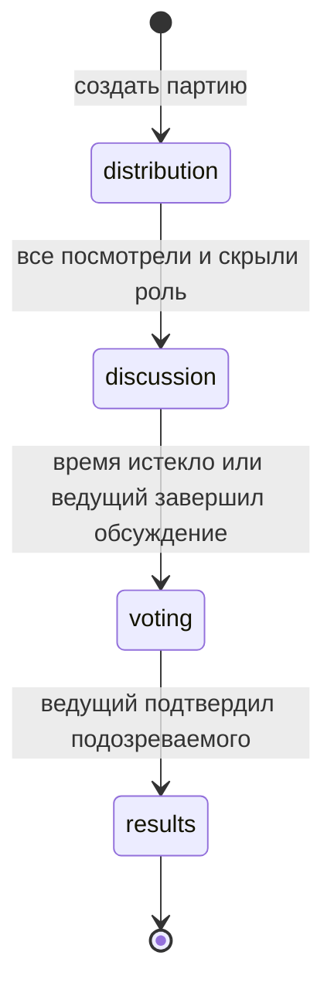

# Правила первого среза: «Шпион»

Рабочая механика для проверки, не обещание точного воспроизведения чужого издания.
Контент в репозитории написан для проекта. Первые настройки: 4–12 игроков, один
шпион, 3–15 минут, по умолчанию 5 минут. Имена после trim непустые; ID уникальны.
Одинаковые имена допустимы: идентичность задаёт ID.

## Фазы

В `distribution` каждый видит закрытую карточку с собственным именем, нажимает
«Показать», читает и нажимает «Скрыть и передать». Все обычные игроки знают одну
локацию; шпион видит только свою роль. Локация выбирается случайно из пакета;
шпион — случайно из состава. Приложение не отправляет роли в логи и аналитику.

Начальный reducer отвечает за выдачу, порядок подтверждений и переходы. Само
скрытие карточки и защита от фона — состояние UI, которое реализуется в следующем срезе.

Обсуждение происходит вслух. Таймер стартует после последней передачи телефона.
По окончании времени начинается выбор подозреваемого; ведущий также может закончить
обсуждение раньше. В первой локальной версии компания голосует вслух, ведущий
вводит коллективный выбор. Это не тайное индивидуальное голосование.

Подтверждение подозреваемого раскрывает роль: выбран шпион → победили остальные,
выбран другой игрок → победил шпион. Ничья решается повторным устным голосованием
до ввода результата. Угадывание локации шпионом, несколько шпионов и очки серии
партий пока не реализуются. Повторный раунд создаёт новую сессию с теми же именами.

## Инварианты и тесты

- Ровно один шпион; у него нет локации в личном представлении.
- Все остальные получают одну локацию.
- Публичная проекция до results не содержит роли, локацию и ID шпиона.
- Показ чужой роли UI не предлагает; ядро требует существующий player ID.
- Подтверждать выдачу может только текущий игрок и только один раз.
- Нельзя перейти к голосованию до discussion и раскрыть результат до voting.
- Неизвестный подозреваемый и повторное завершение отклоняются.
- Время и случайность внедряются, тесты воспроизводимы.

## После первой игры

«Под прикрытием», «Крокодил», «Кто из нас?» и игра на ассоциации остаются кандидатами.
Для каждой сначала отдельная короткая спецификация: состав, шаги, победа, контент,
время, режим одного телефона и сетевые ограничения. Число игр релиза пока открыто.
